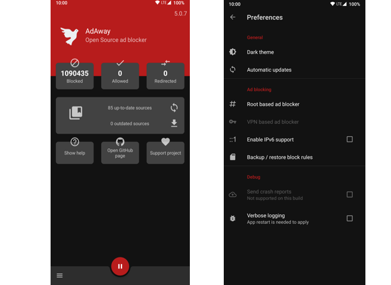

# AdAway Nedir? Android İçin Açık Kaynaklı ve Güçlü Reklam Engelleyici

**AdAway nedir** sorusu, akıllı telefonlarında açılan can sıkıcı reklamlardan, video aralarındaki kesintilerden ve gizliliği tehdit eden veri izleyicilerinden kalıcı olarak kurtulmak isteyen Android kullanıcılarının en sık araştırdığı konulardan biridir. Tarayıcı eklentileri yalnızca web sayfalarını filtrelerken oyunlar, sosyal medya uygulamaları ve diğer mobil yazılımlar reklam göstermeye devam eder. AdAway, sistem genelinde (system-wide) çalışan mimarisiyle telefonunuzdaki tüm reklam trafiğini kaynağında engelleyerek tertemiz, hızlı ve güvenli bir Android deneyimi vadeder.

İster cihazınızı tam yetkiyle root'lamış olun ister fabrikasyon ayarlarda rootsuz kullanın; açık kaynak dünyasının güvenilir projesi AdAway her iki senaryoda da mükemmel çözümler üretir.

- - -

## AdAway Nasıl Çalışır? Root'lu ve Root'suz Çalışma Modları

Geleneksel tarayıcı eklentilerinin aksine AdAway, doğrudan cihazın ağ katmanında görev yapar. Benzer koruma sağlayan [AdGuard reklam engelleme rehberi](https://diyom.blogspot.com/2026/10/adguard-nedir-guvenli-reklam-engelleme-rehberi.html) çözümlerinde olduğu gibi sistem isteklerini filtreleyen AdAway, cihazın root durumuna göre iki temel yöntem kullanır:

### 1. Root'lu Cihazlarda Hosts Dosyası Yöntemi

Cihazınızda root yetkisi bulunduğunda AdAway, Android sisteminin çekirdeğinde yer alan `/system/etc/hosts` dosyasını düzenler. Bilinen reklam, zararlı yazılım ve analiz sunucularının alan adlarını yerel geri döngü IP'sine (`127.0.0.1` veya `0.0.0.0`) yönlendirir. Bir uygulama veya web sitesi reklam çekmek istediğinde istek doğrudan boşluğa düşer. Bu yöntem sıfır arka plan bellek tüketimi sağlar ve cihaz performansını asla düşürmez.

### 2. Root'suz Cihazlarda Yerel VPN Modu

Telefonunu root'lamak istemeyen kullanıcılar için AdAway, cihaz üzerinde yerel bir sanal özel ağ (VPN) servisi başlatır. Bu VPN dışarıdaki uzak bir sunucuya bağlanmaz; tamamen telefonun içinde çalışır. Giden tüm DNS ve ağ sorguları yerel filtreden geçirilir. Reklam sunucularına giden istekler anında bloke edilirken normal internet trafiği kesintisiz akmaya devam eder.

- - -

## AdAway'in Öne Çıkan Gelişmiş Özellikleri

AdAway, basit bir engelleme aracından çok daha fazlasını sunan zengin bir denetim mekanizmasına sahiptir:

* **Sistem Genelinde Reklam ve İzleyici Engelleme:** Sadece tarayıcılarda değil; oyunlar, haber uygulamaları ve ücretsiz araçlardaki banner ile tam ekran reklamları durdurur.
* **Dinamik Kural ve Liste Desteği:** Güvenilir topluluklar tarafından güncellenen reklam engelleme listelerini otomatik olarak indirir ve birleştirir.
* **Beyaz Liste ve Kara Liste (Whitelist / Blacklist):** Reklam engelleyici nedeniyle düzgün çalışmayan bankacılık veya özel servisleri istisna listesine ekleyebilir, istemediğiniz alan adlarını elle engelleyebilirsiniz.
* **Dahili Web Sunucusu:** Engellenen reklam isteklerine yerel olarak boş yanıt vermek isteyen kullanıcılar için dahili mini web sunucusu barındırır.
* **Uygulama Muafiyeti:** Yerel VPN modundayken VPN tüneline girmesini istemediğiniz hassas uygulamaları tek tıkla filtre dışı bırakabilirsiniz.

- - -

## Neden AdAway Tercih Edilmeli? Avantajları Nelerdir?

AdAway kullanmanın mobil kullanıcıya sağladığı başlıca avantajlar şunlardır:

1. **Tamamen Açık Kaynak ve Güvenli:** Uygulamanın kaynak kodları şeffaftır; arka planda kullanıcı verisi toplayan gizli izleyiciler barındırmaz. Bu felsefenin detaylarını [özgür yazılım ve açık kaynak nedir](https://diyom.blogspot.com/2026/10/ozgur-yazilim-ve-acik-kaynak-nedir-farklari-ve-onemi.html) yazımızda inceleyebilirsiniz.
2. **Pil ve Mobil Veri Tasarrufu:** Gösterilmeyen video reklamlar, yüklenmeyen devasa görseller ve engellenen veri madenciliği komutları sayesinde mobil veri kotanız korunur, telefonunuzun batarya ömrü belirgin şekilde uzar.
3. **Resmi Mağazalara Bağımsız Dağıtım:** Google Play reklam politikaları nedeniyle engellenen AdAway'i doğrudan [F-Droid açık kaynak uygulama mağazası](https://diyom.blogspot.com/2026/10/f-droid-nedir-android-acik-kaynak-uygulama-magazasi.html) üzerinden güncel ve güvenli bir şekilde temin edebilirsiniz.

- - -

## AdAway Kurulumu ve İpuçları

AdAway kurulumu oldukça basittir:

1. Güvenilir açık kaynak platformu F-Droid üzerinden veya resmi AdAway GitHub sayfasından güncel APK dosyasını indirin.
2. Uygulamayı ilk kez açtığınızda karşınıza çıkan "Root" veya "VPN" seçeneklerinden cihazınıza uygun olanı seçin.
3. Hosts listelerini güncelle butonuna basarak en son filtre kurallarını indirin.
4. VPN modundaysanız VPN bağlantı iznini onaylayın; root modundaysanız superuser iznini verip cihazınızı bir defa yeniden başlatın.

- - -

## Sıkça Sorulan Sorular (SSS)

### AdAway kullanmak için Android cihazımı root'lamak şart mı?

Hayır, şart değildir. AdAway'in modern sürümleri dahili yerel VPN profili sayesinde hiçbir root yetkisine ihtiyaç duymadan da tüm sistemde reklam engelleme gerçekleştirebilir.

### AdAway telefonumun internet hızını düşürür mü?

Hayır, düşürmez. Root modunda hosts dosyası kullanıldığı için sıfır gecikme oluşur. VPN modu ise trafiği uzak sunuculara göndermeyip yerel döngüde denetlediği için internet hızınızda hissedilir bir yavaşlama yaşanmaz.

### AdAway kişisel verilerimi veya şifrelerimi görebilir mi?

AdAway açık kaynaklıdır ve telemetri içermez. VPN modu tamamen yerel çalıştığından verileriniz herhangi bir üçüncü taraf sunucuya aktarılmaz, tüm filtreleme cihaz içinde kalır.

### Reklam engelleyici bazı uygulamaların açılmasını engellerse ne yapmalıyım?

AdAway menüsündeki "İzin Verilenler (Whitelist)" bölümüne ilgili uygulamanın kullandığı alan adını ekleyebilir veya VPN modunda "Uygulama Dışlama" özelliğini kullanarak o uygulamayı filtre dışı bırakabilirsiniz.
