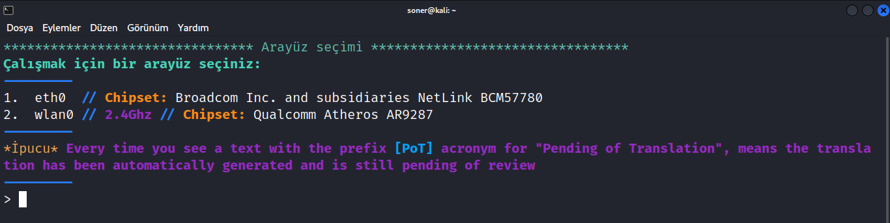
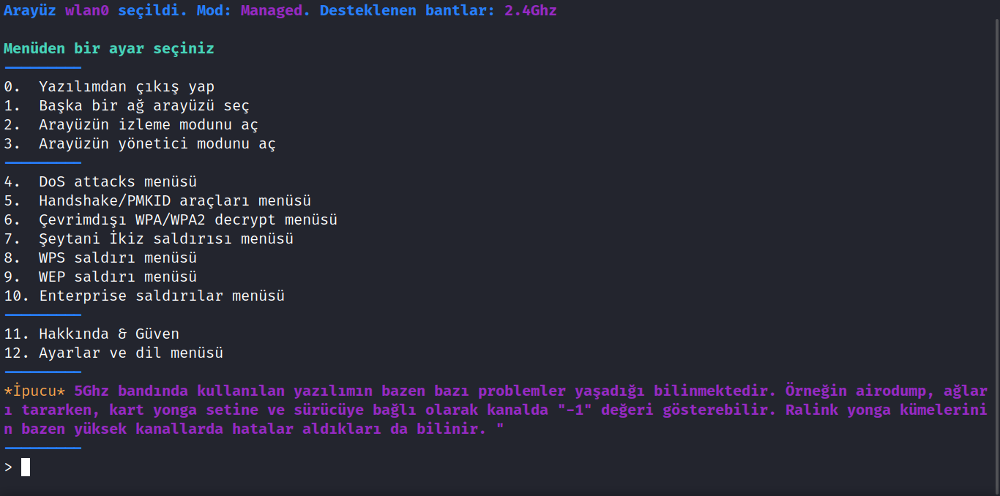
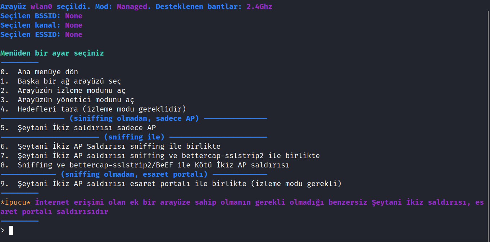

# Kali Linux Airgeddon ile Wi-Fi Kırma ve Evil Twin (Şeytani İkiz) Saldırısı Rehberi

Günümüzde kablosuz ağ (Wi-Fi) teknolojilerinin hayatımızın merkezinde yer alması, kablosuz ağ güvenliğini en kritik konulardan biri haline getirmiştir. İnternet maliyetleri veya bağlantı ihtiyaçları nedeniyle kullanıcılar sık sık "Wi-Fi şifresi nasıl kırılır?" sorusunu araştırmaktadır. Bu yazımızda, sızma testlerinde sıklıkla kullanılan **Airgeddon** aracı ve **Evil Twin Attack (Şeytani İkiz Saldırısı)** kavramını inceleyeceğiz.

*Yasal Uyarı: Bu yazıda anlatılan teknikler yalnızca eğitim, farkındalık ve kendi ağ güvenliğinizi test etme amaçlıdır. İzinsiz başkalarının ağlarına müdahale etmek yasal suç teşkil eder.*

---

## Evil Twin Attack (Şeytani İkiz Saldırısı) Nedir?

Kablosuz cihazlar, çevrelerindeki Wi-Fi ağlarını isimlerine (SSID) göre tanır ve otomatik olarak bağlanmaya çalışır. Aynı ada ve şifreleme türüne sahip birden fazla ağ olduğunda cihazlar genellikle bunlardan birini ayırt edemez. 

**Şeytani İkiz Saldırısı**, hedef ağ ile birebir aynı ada sahip sahte bir erişim noktası oluşturulması esasına dayanır. Doğrudan şifreyi bilmediğimiz durumlarda, gerçek ağdaki kullanıcıları geçici olarak düşürüp sahte ağımıza bağlanmaya zorlayarak bir sosyal mühendislik ekranı (Captive Portal) üzerinden şifreyi girmelerini sağlamak bu saldırının temel mantığıdır.

---

## Airgeddon Nedir ve Nasıl Kurulur?

**Airgeddon**, Kali Linux üzerinde kablosuz ağ denetimleri ve sızma testleri gerçekleştirmek için tasarlanmış kapsamlı bir bash betik aracıdır.

Kali Linux terminalini açarak Airgeddon'ı kolayca kurabilirsiniz:

```bash
sudo apt-get update
sudo apt-get install airgeddon
```

Kurulum tamamlandıktan sonra aracı root yetkileriyle başlatmak için:

```bash
sudo airgeddon
```

komutunu çalıştırmanız yeterlidir. İlk açılışta eksik bağımlılıkları indirmek için program onay isteyecektir; gerekli onayları vererek devam edebilirsiniz.

---

## Adım Adım Airgeddon ile Evil Twin Saldırısı

1. **Ağ Adaptörü Seçimi:** Program açıldığında sizden bir ağ arayüzü seçmeniz istenecektir. Kablosuz ağ işlemleri için kablosuz adaptörünüzün bulunduğu seçeneği (genellikle 2. seçenek) belirleyin.

2. **İzleme Modu (Monitor Mode):** Adaptörünüzü izleme moduna alarak çevredeki ağları taramaya başlayın.

3. **Saldırı Menüsü:** Menüden uygun saldırı modülünü (örneğin 7. seçenek ve Evil Twin / Captive Portal seçenekleri) seçin.

4. **Hedef Ağ Tespiti:** Çevredeki ağlar taranırken hedef ağı belirleyin ve arama işlemini sonlandırarak hedef numarasını girin.
5. **Sahte Erişim Noktası ve Captive Portal:** Airgeddon, seçilen ağın birebir klonunu oluşturur. Kullanıcılar gerçek ağdan koparılarak sahte ağa yönlendirilir ve karşılarına çıkan Türkçe destekli giriş ekranında şifreyi girmeleri istenir. Şifre doğru girildiğinde ekranda açık bir şekilde yakalanır.

---

## Sonuç ve Güvenlik Önerileri

Wi-Fi ağlarının güvenliğini sağlamak için zayıf şifreler yerine WPA3 gibi modern şifreleme standartlarını kullanmak, güçlü ve karmaşık parolalar belirlemek Evil Twin gibi sosyal mühendislik saldırılarına karşı en etkili savunma yöntemidir.
