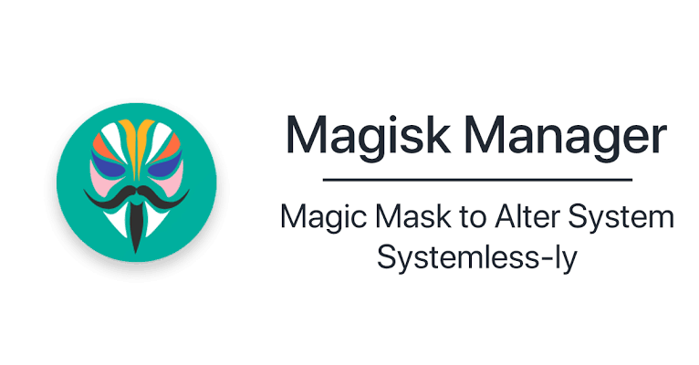
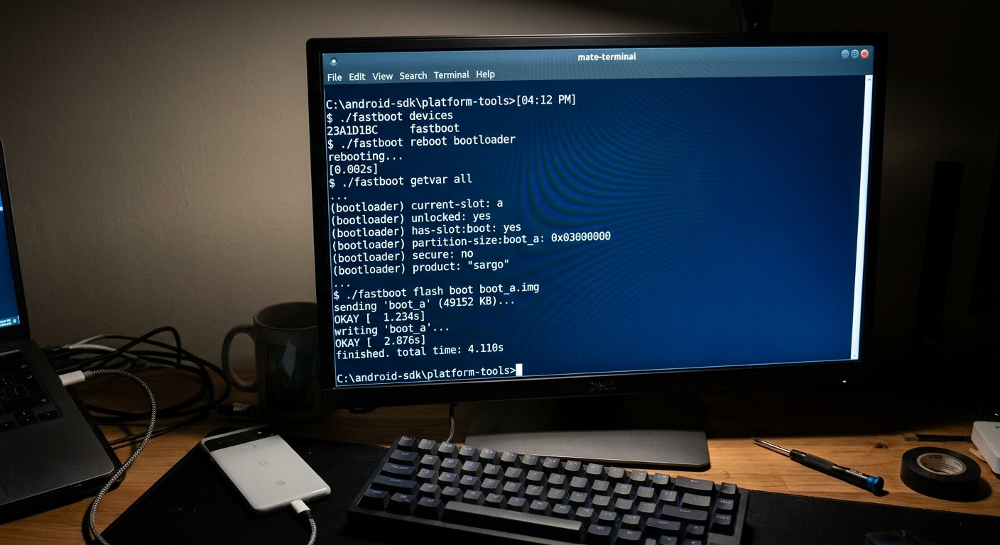
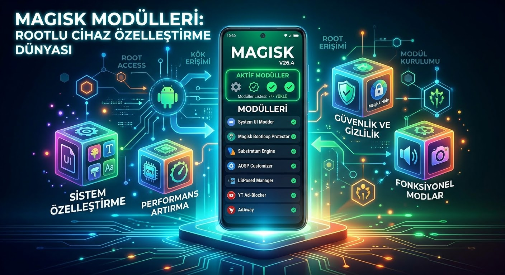

# Android Root Nasıl Yapılır? Magisk ile Adım Adım Rootlama Rehberi


**Android root nasıl yapılır** sorusu, telefonunun sınırlarını zorlamak isteyen her Android kullanıcısının bir noktada sorduğu sorudur. Root işlemi, cihazınızda "Süper Kullanıcı" (Superuser) yetkisi kazanarak üreticinin ve Google'ın koyduğu kısıtlamaları kaldırmanızı sağlar; bu sayede sistem uygulamalarını silebilir, işlemci hızını ayarlayabilir ve Custom ROM kurabilirsiniz. Ancak rootlama, yanlış yapıldığında telefonunuzu açılmaz hale getirebilecek ciddi bir işlemdir. Bu rehberde Android rootlamanın ne olduğunu, faydalarını, risklerini ve günümüzün en güvenilir yöntemi olan **Magisk ile adım adım rootlama** sürecini tüm detaylarıyla ele alacağız.

> ⚠️ **Önemli Uyarı:** Root işlemi cihaz modeline göre değişir. Yanlış yapıldığında telefon açılmaz hale gelebilir. Kendi modelinize özel rehberi XDA Forum'dan mutlaka kontrol edin. Bu yazı genel adımları anlatmaktadır.

---

## Android Root Nedir?

Android, Linux çekirdeği üzerine inşa edilmiş bir işletim sistemidir. Linux sistemlerinde her işlemin belirli yetki seviyeleri vardır; **root** (UID=0) ise bunların en üstündedir. Normal şartlarda Android, her uygulamayı izole bir "kum havuzu" içinde çalıştırır ve sistem dosyalarına erişimi engeller.

**Root atmak**, bu kum havuzu duvarlarını yıkmak ve cihazınızın tüm dosya sistemi üzerinde tam yetki kazanmaktır. Bir bilgisayardaki yönetici (Administrator) hesabını düşünün, ama çok daha derin.

Normal şartlarda birçok uygulamanın ulaşamadığı `/system`, `/data` ve `/vendor` gibi klasörlere root yetkisiyle serbestçe erişebilirsiniz.

---

## Android Root Atmanın Faydaları

### Bloatware Temizliği
Operatör veya üretici tarafından önceden yüklenen ve silinemeyen uygulamaları (bloatware) kaldırabilirsiniz. Bu hem depolama alanı kazandırır hem de pil ömrünü uzatır.

### Magisk Modülleri ile Sınırsız Özelleştirme
Root almanın en büyük avantajlarından biri **Magisk modül ekosistemidir.** Sistem dosyalarına dokunmadan yüzlerce eklenti kurabilirsiniz:

| Modül | Ne İşe Yarar? |
|---|---|
| **PlayIntegrityFix** | Bankacılık ve ödeme uygulamalarını rootlu cihazda çalıştırır |
| **LSPosed** | Xposed Framework altyapısıyla sistem geneli özelleştirme |
| **Viper4Android / JamesDSP** | Profesyonel seviye ses ekolayzer ve kalite artışı |
| **Advanced Charging Controller (ACC)** | Bataryayı %80'de durdurarak pil sağlığını korur |
| **AdAway / bindhosts** | Sistem geneli reklam engelleme (tarayıcı dahil tüm uygulamalar) |

### İşlemci ve Performans Kontrolü
CPU hızını aşırtabilir (overclock) veya düşürerek pil tasarrufu (underclock) yapabilirsiniz. Kernel ayar uygulamalarıyla pil ömrünüzü %20-30 oranında uzatmak mümkündür.

### Custom ROM Özgürlüğü
LineageOS, GrapheneOS veya PixelExperience gibi özel ROM'lar kurabilirsiniz. Bu sayede üretici desteği biten eski cihazınız yıllarca güncel Android sürümleriyle çalışmaya devam edebilir. [Linux Nedir? Açık Kaynak Kodlu İşletim Sistemi ve Popüler Dağıtımlar](https://diyom.blogspot.com/2026/10/linux-nedir-ve-populer-linux-dagitimlari.html) yazımızda açık kaynak dünyasının bu ruhunu daha geniş kapsamda ele aldık.

### Kapsamlı Yedekleme
Root yetkisiyle tüm uygulamaların verilerini (giriş bilgileri, oyun ilerlemeleri dahil) yedekleyebilirsiniz. Normal Android yedeklemeleri bu verilere erişemez.



---

## Android Root Atmanın Riskleri

Root kararı vermeden önce şu riskleri iyi değerlendirmeniz gerekir:

### 🔴 Veri Kaybı (Kesin)
Bootloader kilidini açmak, telefonu fabrika ayarlarına sıfırlar. **Tüm verileriniz silinir.** Bu adımdan önce mutlaka yedek alın.

### 🔴 Garanti Kaybı
Root atmak üretici garantisini geçersiz kılar. **Samsung cihazlarda Knox güvenlik sayacı kalıcı olarak yanar** (`0x1` konumu) ve Samsung Pay, Knox Vault gibi özellikler kalıcı olarak devre dışı kalır.

### 🔴 Brick Riski (Açılmaz Hale Gelme)
Yanlış veya uyumsuz bir dosya flashlamak telefonunuzu kalıcı olarak kullanılamaz hale getirebilir. Özellikle cihaz modeline uymayan `boot.img` dosyaları en yaygın brick sebebidir.

### 🟡 Uygulama Uyumsuzluğu
Google'ın **Play Integrity** (eski adıyla SafetyNet) sistemi, rootlu cihazları tespit edip aşağıdaki uygulamaların çalışmasını engelleyebilir:
- Bankacılık uygulamaları (Garanti, Akbank, İş Bankası vb.)
- Google Cüzdan / Temassız Ödeme
- Netflix (belirli içerik indirme)
- Bazı mobil oyunlar (PUBG, Pokémon GO vb.)

PlayIntegrityFix modülü bu sorunu büyük ölçüde çözse de %100 garanti vermez.

### 🟡 OTA Güncelleme Sorunu
Sistem güncellemeleri (OTA) normal şekilde yüklenmez. Her büyük güncelleme sonrası root işlemini yenilemeniz gerekir.

### 🟡 Güvenlik Riski
Root izni verdiğiniz kötü niyetli bir uygulama, tüm cihaza erişebilir. Güvenilmeyen kaynaklardan uygulama yüklemeyin ve root yetkilerini dikkatli yönetin.

---

## Magisk Nedir ve Neden En İyi Root Yöntemi?

**Magisk**, Android cihazlarda root almanın günümüzdeki altın standardıdır. [topjohnwu](https://github.com/topjohnwu/Magisk) tarafından geliştirilen bu açık kaynaklı araç, "systemless" (sistem bölümüne dokunmayan) mimarisiyle çalışır.

### Magisk'in Avantajları
- **Sistem bölümüne dokunmaz:** Root yetkileri `boot.img` üzerine enjekte edilir, `/system` klasörü değişmez
- **Zygisk ile root gizleme:** Uygulamalar Magisk'in varlığını tespit edemez
- **Modül ekosistemi:** Yüzlerce modülle sistemi özelleştirebilirsiniz
- **Kolay kaldırma:** Magisk'i kaldırmak, stok `boot.img` yüklemek kadar basittir
- **Aktif geliştirme:** Düzenli güncellemeler ve topluluk desteği


---

## Android Root Nasıl Yapılır? Magisk ile Adım Adım Rehber

### Hazırlık Aşaması (Atlamayın!)

Başlamadan önce şunları yapın:

1. **Tüm verilerinizi yedekleyin:** Fotoğraflar, WhatsApp yedekleri, 2FA uygulamaları (Google Authenticator) dahil
2. **Bataryayı %50'nin üzerine şarj edin**
3. **Bilgisayarınıza kurun:**
   - [Android Platform Tools](https://developer.android.com/tools/releases/platform-tools) (adb ve fastboot komutları için)
   - Telefonunuzun USB sürücüleri (Windows için)
4. **XDA Forum'da cihazınızı arayın:** Modele özel adımlar, özel uyarılar ve topluluk deneyimleri için

---

### Adım 1: Geliştirici Seçeneklerini Aktifleştirin

```
Ayarlar → Telefon Hakkında → Yapı Numarası
```

Yapı numarasına **7 kez** dokunun. "Geliştirici oldunuz" mesajını görünce Geliştirici Seçenekleri aktif olur.

Geliştirici Seçenekleri'nden şunları açın:
- ✅ **USB Hata Ayıklama** (USB Debugging)
- ✅ **OEM Kilidi Açma** (OEM Unlocking)

> **Not:** OEM Kilidi Açma seçeneği gri görünüyorsa, cihazı internete bağlı bırakın. Bazı üreticiler (özellikle Xiaomi, Huawei) birkaç günlük bekleme süresi zorunlu kılar.

---

### Adım 2: Bootloader Kilidini Açın ⚠️ (Veri Silinir!)

Telefonu USB ile bilgisayara bağlayın. Komut satırını (CMD veya Terminal) açıp sırayla girin:

```bash
adb reboot bootloader
```

Telefon bootloader moduna geçince:

```bash
fastboot flashing unlock
```

Telefon ekranında bir onay sorusu çıkacak. Ses tuşlarıyla **"Unlock the bootloader"** seçeneğini onaylayın.

> **Xiaomi kullanıcıları:** `fastboot flashing unlock` yerine `fastboot oem unlock` gerekebilir veya Mi Unlock Tool kullanmanız gerekir.

---

### Adım 3: Doğru Firmware Paketini Edinin

Telefonunuzun **tam sürümüyle birebir aynı** stock firmware paketini indirin. Sürümü bulmak için:

```
Ayarlar → Telefon Hakkında → Yazılım Bilgisi → Yapı Numarası
```

Firmware'i şu kaynaklardan bulabilirsiniz:
- **Xiaomi:** [MIUI Firmware Updater](https://github.com/XiaomiEu/miui_update)
- **Samsung:** [SamFW](https://samfw.com)
- **Google Pixel:** Android Factory Images (Google resmi sayfası)
- **Diğerleri:** XDA cihaz forumu

İndirdiğiniz paketi açın ve içinden **`boot.img`** dosyasını çıkarın.

> **Android 13+ dikkat:** Bazı yeni cihazlarda `boot.img` yerine **`init_boot.img`** yamalanması gerekir. XDA forumunuzda kontrol edin.

---

### Adım 4: boot.img'yi Magisk ile Yamalayın

1. [Magisk GitHub Releases](https://github.com/topjohnwu/Magisk/releases) sayfasından **Magisk.apk**'yı indirip telefonunuza kurun
2. `boot.img` dosyasını telefona kopyalayın (İndirilenler klasörüne)
3. Magisk uygulamasını açın → **Install** → **Select and Patch a File**
4. `boot.img` dosyasını seçin
5. Magisk yamalama işlemini tamamlar ve `magisk_patched-xxxx.img` dosyası oluşturur
6. Bu dosyayı bilgisayara geri alın

---

### Adım 5: Yamalı boot.img'yi Flashlayın

Telefonu tekrar bootloader moduna alın:

```bash
adb reboot bootloader
```

Yamalı dosyayı flashlayın:

```bash
fastboot flash boot magisk_patched-xxxx.img
fastboot reboot
```

> `init_boot` kullanan cihazlar için `boot` yerine `init_boot` yazın:
> ```bash
> fastboot flash init_boot magisk_patched-xxxx.img
> ```

---

### Adım 6: Root'u Doğrulayın

Telefon açılınca Magisk uygulamasını açın. Ana ekranda **"Magisk: Installed"** ve sürüm numarası görünüyorsa root başarıyla tamamlanmıştır. 🎉

Root yetkisini test etmek için [Root Checker](https://play.google.com/store/apps/details?id=com.joeykrim.rootcheck) uygulamasını kullanabilirsiniz.

---

## Samsung Cihazlarda Root (Odin Yöntemi)

Samsung, standart fastboot yerine kendi **Odin** aracını kullanır. Genel akış şöyledir:

1. Geliştirici seçeneklerinde OEM Kilidi Açma'yı etkinleştirin
2. Telefonu **Download Mode**'a alın (model bazlı kısayol — XDA'dan öğrenin)
3. [SamFW](https://samfw.com)'den cihazınıza uygun firmware indirin
4. `AP_xxxx.tar` dosyasını Magisk ile yamalayın (`tar` formatı korunmalı)
5. Odin'de yamalı AP dosyasını seçin, flashlayın
6. **Knox sayacı kalıcı olarak `0x1` olur** — bu geri alınamaz

> Samsung Pay, Knox Vault ve bazı kurumsal özellikler Knox yanar yanar sonsuza kadar çalışmaz. Bunu göze alıyorsanız devam edin.

---

## Root Sonrası: Magisk Modülleri ile Gücü Kullanın

Root aldıktan sonra yapmanız gereken ilk şeyler:

### PlayIntegrityFix — Bankacılık Uygulamaları İçin Zorunlu
Magisk → Modules → arama kutusuna "PlayIntegrityFix" yazın, yükleyin, yeniden başlatın. Bankacılık uygulamalarının büyük çoğunluğu artık sorunsuz çalışır.

### Zygisk'i Aktifleştirin
Magisk → Settings → Zygisk'i açın. Bu, root gizleme altyapısını etkinleştirir.

### DenyList Ayarlayın
Magisk → DenyList bölümünden root'tan haberdar olmasını istemediğiniz uygulamaları (bankacılık, oyunlar) listeye ekleyin.

---

## KernelSU ve APatch: Alternatif Root Yöntemleri

Android 12 ve sonrasında Magisk'e iki güçlü rakip doğdu:

- **KernelSU:** Çekirdek (kernel) düzeyinde çalışır, tespit edilmesi daha zordur; ancak destekleyen özel kernel gerektirir
- **APatch:** KernelSU'ya benzer mimaride çalışır, bazı cihazlarda daha iyi uyumluluk sunar

Her iki yöntem de gelişmiş kullanıcılar içindir. Başlangıç için Magisk her zaman en güvenli seçenektir.

---

## Sorun Giderme

**Telefon açılmıyorsa (soft brick):**
Stok `boot.img` dosyasını fastboot ile tekrar flashlayın:
```bash
fastboot flash boot stock_boot.img
fastboot reboot
```

**Root'u tamamen kaldırmak istiyorsanız:**
Magisk → Uninstall → Complete Uninstall seçeneği ile temiz kaldırabilir ya da stok boot imajını flashlayabilirsiniz.

**OTA güncelleme aldıktan sonra root gitti:**
Yeni sürümün `boot.img`'sini Magisk ile tekrar yamalayıp flashlayın. Bu her büyük güncelleme için tekrarlanması gereken bir adımdır.

---

## Root ile Birlikte Kullanabileceğiniz Araçlar

Root yetkisini en verimli şekilde kullanmak için bazı araçlarla birleştirmenizi öneririz:

- **[AdAway](https://sonersrnnn.github.io/adaway-nedir-android-icin-acik-kaynakli-reklam-engelleyici/):** Root erişimiyle sistem geneli reklam engelleme, tüm uygulamalarda reklamsız deneyim
- **[MTKClient ile HyperOS 2 Bootloader Kilidi Açma](https://sonersrnnn.github.io/mtkclient-ile-hyperos-2-bootloader-kilidi-acma/):** MediaTek işlemcili cihazlarda bootloader kilidini açma rehberi
- **[ReVanced YouTube](https://sonersrnnn.github.io/revanced-youtube-nedir-ozellikleri-ve-kullanim-rehberi-indir/):** Root ile birlikte çalışan gelişmiş YouTube modu

---

## Sıkça Sorulan Sorular (SSS)

**Android root atmak yasal mı?**
Evet, kendi cihazınızı rootlamak Türkiye'de yasal bir işlemdir. Ancak üretici garantinizi kaybedersiniz ve bazı hizmet şartları ihlal edilebilir. Root ile yapılan faaliyetlerin hukuki sorumluluğu kullanıcıya aittir.

**Root atmak telefonu yavaşlatır mı?**
Hayır, aksine doğru yapıldığında performansı artırabilir. Gereksiz sistem uygulamalarını kaldırabilir, CPU governor ayarlarını optimize edebilir ve pil tüketen arka plan servislerini durdurabilirsiniz.

**Root atmadan önce ne yapmalıyım?**
Tüm verilerinizi yedekleyin, XDA Forum'da cihazınıza özel rehberi okuyun, bataryayı %50'nin üzerine şarj edin ve bilgisayarınıza ADB/Fastboot araçlarını kurun.

**Bankacılık uygulamaları rootlu cihazda çalışır mı?**
PlayIntegrityFix Magisk modülü yüklendikten sonra çoğu bankacılık uygulaması çalışır; ancak bazı agresif güvenlik sistemleri kullanan uygulamalar hâlâ sorun çıkarabilir. Garanti vermek mümkün değildir.

**Samsung telefonumu root attıktan sonra Knox'u geri alabilir miyim?**
Hayır. Knox güvenlik sayacı bir kez yandıktan sonra sıfırlanması mümkün değildir. Samsung Pay ve Knox temelli kurumsal uygulamalar kalıcı olarak devre dışı kalır.

---

## Sonuç

**Android root** işlemi, telefonunuzun gerçek potansiyelini ortaya çıkarmak için güçlü bir araçtır. Magisk'in systemless mimarisi ve zengin modül ekosistemi sayesinde bugün rootlama, geçmişe kıyasla çok daha güvenli ve esnek bir hale geldi. Ancak bootloader kilidi açmanın veri silme zorunluluğu, Knox gibi geri dönüşsüz değişiklikler ve Play Integrity uyumsuzlukları gibi riskler göz önüne alındığında, bu kararı iyice düşünmek ve cihazınıza özel XDA rehberlerini okumak şarttır. Riskleri kabul ediyor ve tam kontrol istiyorsanız, Magisk ile Android root maceranız oldukça tatmin edici olacaktır.

---
