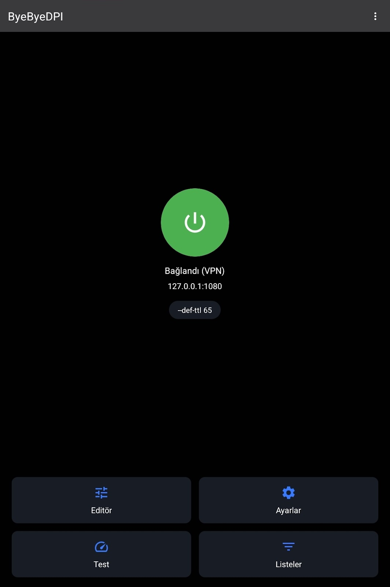
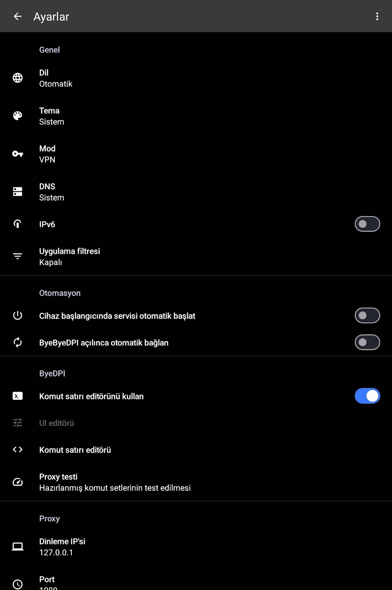
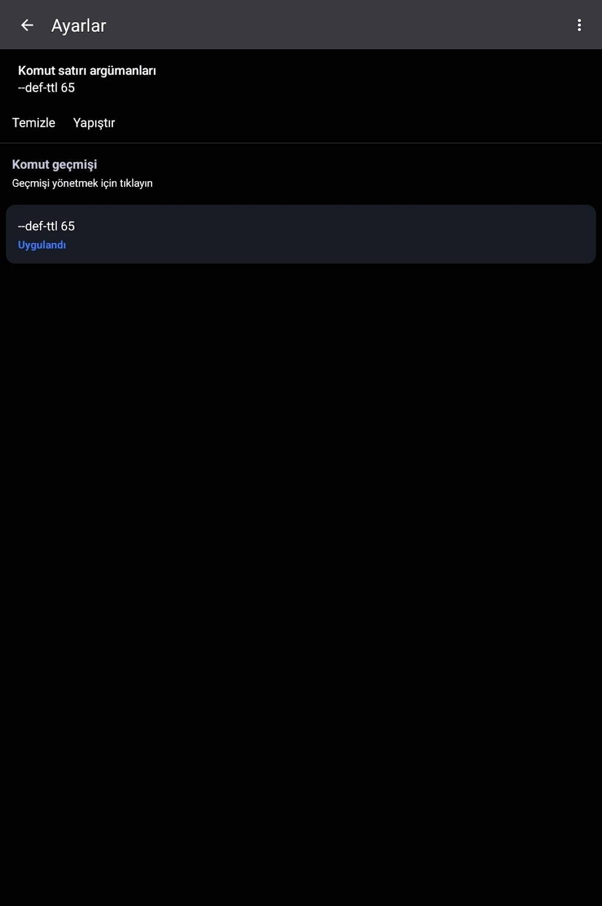

# ByeByeDPI Nedir? Android'de Rootsuz Hotspot Sınırı ve DPI Aşma Rehberi

Mobil internet kullanıcılarının en büyük şikayetlerinden biri, operatörlerin (Turkcell, Vodafone, Türk Telekom) sundukları sınırsız veya yüksek kotalı internet paketlerinde hotspot (internet paylaşımı) kısıtlamaları getirmesidir. Bilgisayarınıza veya tabletinize internet paylaştığınızda ek ücret ödemek zorunda kalabilir ya da sınırlı hotspot kotanızın hızla bittiğini görebilirsiniz. 

Bu yazımızda, ByeByeDPI aracını inceleyerek, Derin Paket Denetimi (DPI) sistemlerini cihaz üzerinde nasıl atlayabileceğinizi ve TTL (Time to Live) manipülasyonu ile rootsuz bir şekilde hotspot sınırlarını nasıl ortadan kaldırabileceğinizi detaylıca ele alacağız.

---

## ByeByeDPI Nedir ve Nasıl Çalışır?

ByeByeDPI, internet servis sağlayıcılarının ağ trafiğini denetlemek ve kısıtlamak için kullandığı Derin Paket Denetimi (DPI) mekanizmalarını cihazınızda yerel olarak baypas etmenizi sağlayan açık kaynaklı bir uygulamadır.

* **VPN Değildir:** Milyonlarca kullanıcının kafasını karıştıran en önemli nokta budur. ByeByeDPI trafiğinizi uzak bir sunucuya şifreleyerek göndermez, IP adresinizi gizlemez. Android cihazınızın yerel VPN API altyapısını, paketleri cihaz içinde süzgeçten geçirmek ve manipüle etmek için kullanır.
* **Paket Parçalama:** TCP/IP veri paketlerini yerel düzeyde parçalayarak ve değiştirerek sansür ve engelleme sistemlerinin yasaklı siteleri veya kısıtlı protokolleri tespit etmesini imkansızlaştırır.

ByeByeDPI, uygulama Android TV/Box desteği, otomatik başlatma ve bölünmüş tünelleme (split tunneling)]] gibi gelişmiş özellikler sunar.

---

## Operatörler Hotspot Paylaşımını Nasıl Anlar? (TTL Mantığı)

Normal şartlarda telefonunuzdan mobil veriyi doğrudan kullandığınızda internete erişimde sorun yaşamazsınız. Ancak "Mobil Erişim Noktası" (Hotspot) açıp bilgisayarınızı bağladığınızda operatörler bu durumu anında tespit eder ve hotspot kotanızı harcamaya başlar. Peki sistem arkada nasıl işler?

1. **Varsayılan TTL (64):** Android işletim sisteminde ağ paketlerinin varsayılan TTL (Time to Live) değeri 64'tür. Bu sayaç, bir paketin ağ içinde kaç yönlendiriciden (hop) geçebileceğini gösterir.
2. **Hotspot ve TTL Düşüşü:** Telefonunuzdan interneti bizzat kullanırken paketler doğrudan operatöre ulaşır. Ancak interneti başka bir cihaza paylaştığınızda, paketler önce telefondan (yönlendiriciden) geçer ve TTL değeri bir azalarak **63** olur.
3. **Operatör Denetimi:** GSM operatörleri gelen paketlerin TTL değerinin 63 (veya benzeri düşmüş değerler) olduğunu gördüğünde, internetin başka bir cihaza paylaşıldığını anlar ve kotanızı sınırlar (örneğin Vodafone sınırsız tarifesindeki 15 GB hotspot sınırı).

---

## ByeByeDPI ile Rootsuz Hotspot Sınırı Nasıl Kaldırılır?

Root yetkisi (yönetici erişimi) gerektirmeden, Android cihazınızın VPN arayüzünü kullanarak TTL değerini manipüle edebilir ve operatörün sizi normal telefon trafiği olarak algılamasını sağlayabilirsiniz.


|            |            |            |
| ---------- | ---------- | ---------- |
|  |  |  |

### Adım Adım Kurulum ve Ayar Rehberi

1. **Uygulamayı Edinin:** ByeByeDPI Android uygulamasını cihazınıza indirin ve kurun.
2. **Ayarlar Menüsüne Girin:** Uygulamayı açtıktan sonra `Settings` (Ayarlar) bölümüne gidin.
3. **Komut Satırı Düzenleyicisi:** Komut satırı (Command-line) editörü menüsünü açın.
4. **TTL Değerini Girin:** Aşağıdaki komutu ekleyin:
   ```bash
   --def-ttl 65
   ```
   *(Not: Alternatif olarak 127 gibi değerler de senaryoya göre kullanılabilir).*
5. **Bağlantıyı Başlatın:** Ayarları kaydedin ve uygulamadaki ana başlatma düğmesine dokunarak servisi aktifleştirin.

Artık ekranınızda VPN bağlıymış gibi bir simge görünecektir; ancak hiçbir dış VPN sunucusuna bağlanmıyorsunuz. Android'in yerel API'si üzerinden paketleriniz manipüle edilmekte ve hotspot bağlanan cihazların trafiği operatör tarafından doğrudan telefonun kendi trafiği (TTL 64/65) olarak kabul edilmektedir.

---

## Sonuç

ByeByeDPI, engellemelerini aşmak ve operatörlerin haksız hotspot kotalarından kurtulmak için root gerektirmeyen son derece güçlü ve hafif bir çözümdür. Bilgisayarınızı veya tabletinizi mobil veriniz üzerinden sınırlara takılmadan güvenle kullanabilirsiniz.
