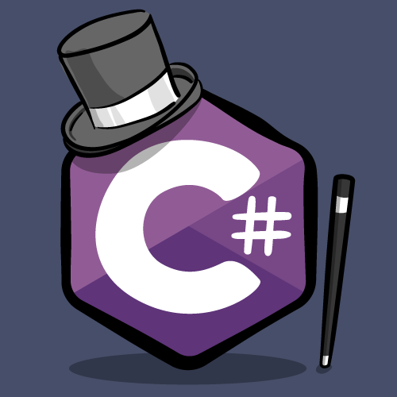

# C# (C Sharp) Programlama Dili ile Neler Yapılabilir? Kapsamlı Rehber

Yazılım dünyasına adım atmak isteyenlerin veya kariyerini güçlendirmek isteyen geliştiricilerin en sık tercih ettiği dillerin başında **C# (C Sharp)** gelir. Microsoft tarafından geliştirilen, modern ve nesne yönelimli yapısıyla öne çıkan bu dil, günümüzde pek çok farklı platformda endüstri standardı haline gelmiştir.

Peki C# nedir, arkasındaki .NET altyapısı nasıl çalışır ve bu güçlü dille tam olarak neler inşa edebilirsiniz? Bu kapsamlı rehberimizde tüm bu soruların yanıtlarını detaylıca inceleyeceğiz.

## C# (C Sharp) Nedir?

C#, Microsoft tarafından Anders Hejlsberg liderliğinde geliştirilen nesne yönelimli (OOP) bir programlama dilidir. Köken olarak C ve C++ dillerinden esinlenen, modern sentaks yapısıyla Java'ya büyük ölçüde benzeyen C#, sunduğu gelişmiş hata ayıklama (debugger) yetenekleri sayesinde geliştiricilerin hataları hızla tespit etmesini sağlar.

### .NET Framework ve .NET Altyapısı Nasıl Çalışır?

C# kodları doğrudan makine diline derlenmez. İlk aşamada **MIL (Microsoft Intermediate Language)** adı verilen bir ara koda dönüştürülür. Ardından **.NET Framework / .NET** altyapısı devreye girerek bu ara kodu işletim sisteminin çalıştırabileceği formata tercüme eder. Bu mimari, C# uygulamalarının kararlı ve güvenli bir şekilde çalışmasını sağlar.

## C# Programlama Dili ile Neler Yapılabilir?

C# ile hayal ettiğiniz pek çok farklı alanda profesyonel projeler geliştirebilirsiniz. İşte C#'ın en yaygın kullanım alanları:

### 1. Web Uygulamaları ve API'ler (ASP.NET Core)

Modern web dünyasında dinamik web siteleri ve yüksek performanslı backend servisleri geliştirmek için **ASP.NET Core** kullanılır. C# ile geliştirilen web uygulamaları, ölçeklenebilir yapıları ve XML/JSON entegrasyonlarıyla kurumsal düzeyde projelerin vazgeçilmezidir.

### 2. Oyun Geliştirme (Unity Oyun Motoru)

Eğer oyun dünyasına ilgi duyuyorsanız ve kodlama tarafında uzmanlaşmak istiyorsanız C# bilmeniz şarttır. Dünyanın en popüler oyun motorlarından biri olan **Unity**, oyun içi mantığı (scripting) yazmak için ana dil olarak C# kullanır. Mobil oyunlardan büyük bütçeli PC oyunlarına kadar binlerce yapım C# ile hayat bulmaktadır.

### 3. Masaüstü Uygulamaları (Windows Forms ve WPF)

Windows ekosisteminde çalışan grafik arayüzlü (GUI) programlar geliştirmek için C# harika bir tercihtir. **Windows Forms** ve **WPF (Windows Presentation Foundation)** teknolojileri sayesinde Steam gibi popüler masaüstü yazılımlarına benzer güçlü uygulamalar tasarlayabilirsiniz.

### 4. Mobil Uygulama Geliştirme (.NET MAUI ve Xamarin)

Çapraz platform mobil uygulama geliştirme araçları sayesinde, C# bilgisiyle hem Android hem de iOS platformları için tek bir kod tabanı üzerinden mobil uygulamalar üretebilirsiniz.

### 5. Konsol Uygulamaları ve DLL Kütüphaneleri

Komut satırı (CMD) tabanlı araçlar veya sürekli tekrar eden kod bloklarını tek bir yerde toplamak için **DLL (Dynamic Link Library - Dinamik Kod Kütüphanesi)** dosyaları yazabilir, projelerinizde kod tekrarını önleyebilirsiniz.

- - -
