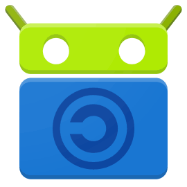
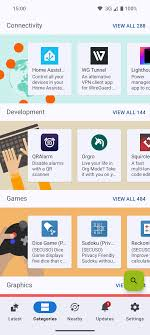

# F-Droid Nedir? Android Açık Kaynak Uygulama Mağazası



F-Droid nedir sorusunun en yalın yanıtı; Android işletim sistemi için geliştirilmiş, yalnızca özgür ve açık kaynak kodlu (FOSS) yazılımları barındıran, bağımsız ve gizlilik odaklı alternatif bir uygulama mağazasıdır. Günümüzde akıllı telefon kullanıcılarının en büyük endişesi, resmi uygulama marketlerindeki gizli veri takibi, can sıkıcı reklamlar ve zorunlu kullanıcı hesaplarıdır. Google Play Store üzerinde yer alan sayısız uygulamanın arka planda hangi kişisel verilerinizi topladığını bilmek neredeyse imkansızdır. İşte F-Droid, hiçbir hesap kaydı gerektirmeyen, şeffaf kod tabanına sahip, sansüre dayanıklı ve tamamen ücretsiz binlerce güvenlik ve verimlilik uygulamasını kullanıcılarla buluşturarak bu sorunu kökten çözmektedir.

Cihazınızın kontrolünü yeniden elinize almak, ticari gözetimden kurtulmak ve açık kaynak topluluğunun geliştirdiği özgür yazılımları keşfetmek istiyorsanız, F-Droid Android cihazınız için en güvenilir sığınaktır.

- - -

## F-Droid Nedir ve Google Play Store'dan Farkları Nelerdir?

F-Droid, Google ekosistemine bağımlı kalmadan Android telefonunuza uygulama yüklemenizi sağlayan kar amacı gütmeyen bir yazılım deposudur. Google Play Store'dan en temel farkı, kataloğuna kabul ettiği her uygulamanın kaynak kodlarının kamuya açık ve özgür lisanslı olmasını zorunlu kılmasıdır. 

Play Store'da bulunan uygulamaların büyük kısmı kapalı kaynaklıdır ve kullanıcıların davranışlarını analiz eden ticari izleyiciler içerir. Oysa F-Droid, sunucularında barındırdığı uygulamaları doğrudan açık kaynak kodlarından kendisi derler ve kendi imza anahtarlarıyla paketler. Üstelik bir uygulama aramak veya güncellemek için Google hesabına, e-posta adresine ya da telefon numarasına kesinlikle ihtiyaç duymazsınız.

> **Önemli Tanım:** F-Droid, kullanıcı gizliliğini ve dijital hakları merkezine alan, yalnızca GPL, Apache veya MIT gibi özgür lisanslarla dağıtılan Android uygulamalarını sunan topluluk destekli bir yazılım kütüphanesidir.

- - -

## Google Play Store ile F-Droid Karşılaştırması

Aşağıdaki tablo, standart uygulama mağazası ile F-Droid arasındaki felsefi ve teknik farkları net bir şekilde ortaya koymaktadır:

| Özellik                     | Google Play Store                             | F-Droid                                    |
| --------------------------- | --------------------------------------------- | ------------------------------------------ |
| **Yazılım Felsefesi**       | Kapalı kaynak ve ticari uygulamalar ağırlıklı | Yalnızca Özgür ve Açık Kaynak (FOSS)       |
| **Hesap Zorunluluğu**       | Zorunlu Google hesabı gerektirir              | **Hesap gerektirmez, tamamen anonim**      |
| **İzleme ve Telemetri**     | Yaygın kullanıcı ve davranış takibi           | Sıfır kullanıcı takibi, gizlilik odaklı    |
| **Uygulama İçi Reklamlar**  | Çok yaygın ve zorunlu                         | Reklamsız yazılımlar önceliklidir          |
| **Anti-Özellik Uyarısı**    | Yok (kullanıcı uyarılmaz)                     | **Şeffaf Anti-Özellik etiketleri bulunur** |
| **Özel Depo Desteği**       | Desteklemez (yalnızca tek merkez)             | Sınırsız üçüncü taraf depo ekleme          |
| **Sansür ve Tor Desteği**   | Bölgesel kısıtlamalar uygulanır               | Tor (.onion) depoları ile sansürsüz        |
| **Uygulama İçi Satın Alım** | Yaygın                                        | Tamamen ücretsiz, ödeme duvarı yok         |

- - -

## F-Droid'in Öne Çıkan Güvenlik ve Gizlilik Avantajları

F-Droid kullanmanın kullanıcılara sunduğu ayrıcalıklar sadece ücretsiz yazılım indirmekle sınırlı değildir. Platformun sunduğu öne çıkan avantajlar şunlardır:

1. **Bağımsız Topluluk Derlemesi:** F-Droid ekibi, geliştiricilerin gönderdiği hazır APK'ları kabul etmek yerine kaynak kodları sıfırdan kendi sunucularında derler. Bu yöntem, geliştiricinin bile sonradan koda arka kapı eklemesini engeller.
2. **Kapsamlı Gizlilik Koruyucuları:** Reklamları kökten engelleyen [AdAway Nedir? Android İçin Açık Kaynaklı Reklam Engelleyici](https://sonersrnnn.github.io/adaway-nedir-android-icin-acik-kaynakli-reklam-engelleyici/) gibi kök dizin seviyesinde güvenlik sağlayan araçlara F-Droid üzerinden doğrudan ulaşabilirsiniz.
3. **Şifre ve Kimlik Güvenliği:** Hesap bilgilerinizi ve parolalarınızı cihazınızda yerel olarak şifreleyen [KeePassDX: Android Güvenli Şifre Yöneticisi Rehberi](https://sonersrnnn.github.io/keeppassdx-android-guvenli-sifre-yoneticisi/) gibi açık kaynak şifre yöneticilerini güvenle indirebilirsiniz.
4. **YouTube İçin Özgür İstemciler:** Google servislerine bağımlı olmadan video izlemenizi sağlayan [NewPipe: YouTube Premium Özelliklerini Ücretsiz Kullanma Rehberi](https://sonersrnnn.github.io/newpipe-youtube-premium-ucretsiz-kullanim-rehberi/) gibi güçlü medya istemcileri F-Droid'in en popüler uygulamaları arasındadır.

- - -

## Anti-Özellikler (Anti-Features) Nedir ve Nasıl Çalışır?

F-Droid ekosisteminin en dürüst ve şeffaf yanı, "Anti-Özellikler" (Anti-Features) adı verilen bilgilendirme mekanizmasıdır. Bir yazılımın kaynak kodu açık olsa dahi, eğer kullanıcının mahremiyetini veya özerkliğini zedeleyebilecek unsurlar barındırıyorsa, F-Droid bu durumu uygulama sayfasında kırmızı uyarılarla açıkça belirtir.

Yaygın olarak etiketlenen anti-özellikler şunlardır:

* **Reklam İçerir (Ads):** Uygulamanın içinde reklam gösteren bileşenlerin yer aldığını bildirir.
* **Kullanıcıyı İzler (Tracking):** Uygulamanın anonim dahi olsa kullanım istatistikleri veya telemetri verisi topladığını gösterir.
* **Özgür Olmayan Ağ Hizmetlerine Bağımlıdır:** Yazılımın istemcisi açık kaynak olsa da arka planda kapalı kaynaklı sunucularla (örneğin ticari bulut sistemleri) iletişim kurduğunu belirtir.
* **Özgür Olmayan Bağımlılıklar İçerir:** Uygulamanın çalışmak için Google Play Hizmetleri gibi kapalı kütüphanelere ihtiyaç duyduğunu kullanıcıya haber verir.


|                   |
| ----------------- |
|  |


Bu sayede hiçbir sürprizle karşılaşmaz, hangi tavizi verdiğinizi tam olarak bilerek indirme kararı alırsınız.

- - -

## F-Droid APK Nasıl İndirilir ve Kurulur? (Adım Adım)

Google Play Store'un rekabet kısıtlamaları nedeniyle F-Droid istemcisi Play Store'da bulunmaz. Uygulamayı telefonunuza kurmak oldukça basittir:

```
[Resmi Siteden APK İndir] ➔ [Bilinmeyen Kaynaklara İzin Ver] ➔ [Paketi Yükle] ➔ [Depoları Güncelle]
```

### Adım Adım Kurulum Kılavuzu:

1. **Resmi APK Dosyasını İndirin:** Tarayıcınız üzerinden resmi web sitesine (`f-droid.org`) gidin ve güncel "F-Droid APK İndir" butonuna dokunun.
2. **Bilinmeyen Kaynaklara İzin Verin:** Android güvenlik ayarlarından kullandığınız tarayıcıya (Chrome, Brave vb.) "Bilinmeyen uygulamaları yükle" izni tanıyın.
3. **Kurulumu Tamamlayın:** İndirilen APK dosyasına dokunarak kurulumu onaylayın.
4. **Depo Senkronizasyonu:** Uygulamayı ilk kez açtığınızda resmi yazılım depolarının endekslenmesi için birkaç saniye bekleyin. Güncel katalog yüklendiğinde dilediğiniz uygulamayı tek dokunuşla kurmaya başlayabilirsiniz.

- - -

## Özel Depolar, Tor Desteği ve Çevrimdışı Uygulama Paylaşımı

F-Droid, sadece tek bir sunucuya mahkum kalmayacağınız esnek ve merkeziyetsiz bir mimariye sahiptir:

* **Özel Yazılım Depoları (Custom Repositories):** CalyxOS, Guardian Project veya bağımsız geliştiricilerin depolarını QR kod taratarak veya bağlantı ekleyerek mağazanıza entegre edebilirsiniz.
* **Tor ve .onion Desteği:** Sansür uygulanan ülkelerde veya izlenmek istemediğiniz ağlarda Tor proxy desteğini aktifleştirerek depoları `.onion` adresleri üzerinden tamamen anonim indirebilirsiniz.
* **İnternetsiz Yerel Paylaşım (P2P):** Doğal afetlerde, internet kesintilerinde veya hücresel verinizin olmadığı anlarda; yakınınızdaki başka bir F-Droid kullanıcısıyla Wi-Fi ya da Bluetooth üzerinden internet harcamadan doğrudan uygulama takası yapabilirsiniz.

- - -

## Sıkça Sorulan Sorular (SSS)

### F-Droid kullanmak yasal ve güvenli midir?

Evet, F-Droid tamamen yasal, kar amacı gütmeyen ve güvenilir bir projedir. Mağazadaki tüm uygulamalar açık kaynaklı kodlardan topluluk denetimiyle derlenir. Google Play Store'daki pek çok tescilli uygulamaya kıyasla gizli casus yazılım ve izleyici barındırmadığı için çok daha güvenlidir.

### F-Droid üzerinde WhatsApp veya Instagram bulunur mu?

Hayır, F-Droid kataloğunda WhatsApp, Instagram veya Spotify gibi kapalı kaynaklı ve tescilli ticari uygulamalar yer almaz. Mağazanın temel ilkesi yalnızca kaynak kodu incelenebilir özgür yazılımları sunmaktır. Bu uygulamaların yerine gizlilik odaklı açık kaynak alternatifleri tercih edebilirsiniz.

### F-Droid uygulamaları otomatik olarak güncellenir mi?

Evet, F-Droid istemcisi yüklü uygulamaların yeni sürümlerini düzenli aralıklarla denetler ve bildirim gönderir. Android 12 ve üzeri modern sürümlerde veya Shizuku ve root entegrasyonu sağlandığında güncellemeler arka planda sessizce ve otomatik olarak yüklenebilir.

### Uygulamaları güncellemek için neden tekrar F-Droid'den yüklemeliyim?

F-Droid, paket güvenliğini garanti altına almak için tüm uygulamaları kendi resmi imza anahtarıyla imzalar. Google Play Store'dan veya APKMirror üzerinden yüklediğiniz bir uygulama farklı geliştirici imzası taşıdığı için imza çakışması yaşanır; bu nedenle uygulamanın F-Droid sürümüne geçiş yapılması gerekir.

- - -

## Sonuç

F-Droid, dijital mahremiyetine değer veren, reklamlardan ve gözetim kapitalizminden uzak durmak isteyen tüm Android kullanıcıları için vazgeçilmez bir açık kaynak ekosistemidir. Kayıt gerektirmeyen şeffaf yapısı, zengin araç kütüphanesi ve sansüre meydan okuyan teknolojisiyle mobil dünyada tam bağımsızlık sağlar. Siz de F-Droid istemcisini cihazınıza kurarak özgür yazılım dünyasının kapılarını hemen aralayabilirsiniz.

- - -
