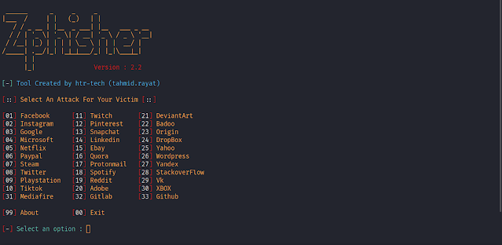

# Kali Linux Instagram Şifre Kırma ve Phishing (Oltalama) Saldırısı Rehberi

Sosyal medya hesaplarının güvenliği ve şifre koruması günümüzde büyük önem taşımaktadır. İnternette "Instagram şifre kırma" araması yapan kullanıcılar pek çok yöntemle karşılaşmaktadır. Bu yazımızda, sızma testlerinde sıklıkla ele alınan **Phishing (Oltalama)** saldırı mantığını ve **Zphisher** aracının Kali Linux üzerinde nasıl kullanıldığını inceleyeceğiz.

*Yasal Uyarı: Bu yazıda paylaşılan bilgiler yalnızca siber güvenlik eğitimi, farkındalık ve kendi sistemlerinizi test etme amacıyla sunulmuştur. Başkalarının hesaplarına izinsiz erişim sağlamak yasal suç teşkil eder.*

---

## Phishing (Oltalama) Yöntemi Nedir?

Oltalama, saldırganların meşru bir servis veya platform (Instagram, Facebook vb.) gibi görünerek kullanıcıları kandırması esasına dayanan bir sosyal mühendislik yöntemidir. 

Bu yöntemde, tünelleme teknikleriyle oluşturulan sahte bir giriş sayfası linki hedefe iletilir. Kullanıcı bu bağlantıya tıklayıp kendi kullanıcı adı ve şifresini girdiğinde, girilen kimlik bilgileri saldırganın sistemine düşer ve hesap bilgileri ele geçirilmiş olur.

---

## Kali Linux Üzerinde Zphisher ile Oltalama Testi

Kali Linux üzerinde sosyal mühendislik testleri gerçekleştirmek için **Zphisher** aracı yaygın olarak kullanılmaktadır. Terminal üzerinden adım adım kurulum ve kullanım şu şekildedir:

### 1. Aracı İndirme ve Kurulum
Terminali açın ve şu komutları sırasıyla uygulayın:

```bash
sudo git clone https://github.com/htr-tech/zphisher.git
cd zphisher
sudo chmod +x zphisher.sh
```

### 2. Aracı Çalıştırma
Gerekli yetkileri verdikten sonra programı başlatın:

```bash
sudo bash zphisher.sh
```

İlk çalıştırılmada eksik bağımlılıklar ve paketler internet hızınıza bağlı olarak indirilecektir.


### 3. Platform ve Şablon Seçimi
Program açıldığında karşınıza gelen menüden test etmek istediğiniz platformu seçin (Örn: Instagram için `02` numaralı seçenek). Ardından geleneksel giriş sayfası şablonunu seçerek devam edin.

### 4. Bağlantı Oluşturma ve Veri Takibi
Oluşturulan tünel bağlantısını (linki) test ortamında kullanarak sahte arayüze ulaşabilirsiniz. Kullanıcı bu arayüze giriş yaptığında bilgiler terminal ekranına düşecek ve programın kurulduğu dizindeki `usernames.dat` dosyasına kaydedilecektir.

---

## Sonuç

Sosyal mühendislik ve oltalama saldırılarına karşı iki aşamalı doğrulama (2FA) kullanmak ve bilinmeyen bağlantılara karşı dikkatli olmak en etkili savunma yöntemidir.
