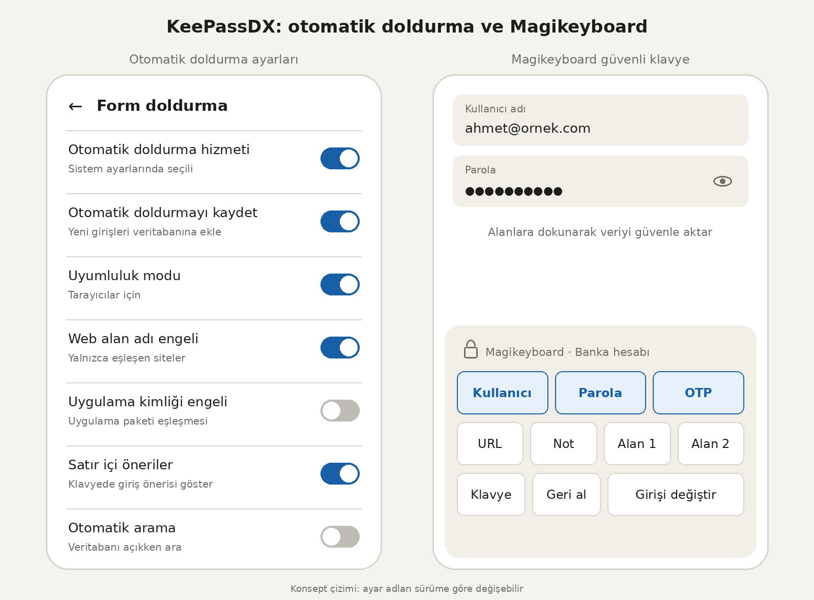

# KeePassDX ile Android İçin Güvenli Şifre Yönetimi Rehberi

**KeePassDX**, dijital hesaplarımızın güvenliğini sağlamak ve karmaşık parolaları tek bir merkezden yönetmek için geliştirilmiş en güçlü açık kaynaklı Android şifre yöneticisi çözümlerinden biridir. Yüzlerce farklı şifreyi hafızada tutmanın imkansız olduğu günümüzde, verilerinizi üçüncü taraf bulut sunucularına emanet etmeden tamamen yerel ve şifreli bir kasada saklamanızı sağlar. Mobil cihazınızda tam veri gizliliği sağlamak için tıpkı [AdAway reklam engelleyici](https://sonersrnnn.github.io/adaway-nedir-android-icin-acik-kaynakli-reklam-engelleyici/) ile zararlı içerikleri engellediğiniz veya [SafeDot kamera ve mikrofon uyarısı](https://sonersrnnn.github.io/safedot-telefon-kamerasi-ve-mikrofonu-kullanildiginda-uyarir/) kullanarak izinsiz erişimleri denetlediğiniz gibi, parolalarınızı da şifreli bir yerel kasada korumanız gerekir. Bu rehberde KeePassDX uygulamasının sunduğu özellikleri, masaüstü senkronizasyonunu ve mobil cihazınızda en üst düzey güvenlik sağlayarak şifrelerinizi nasıl yönetebileceğinizi inceleyeceğiz.

## KeePassDX Nedir ve Neden Tercih Edilmelidir?

*Görsel Önerisi: KeePassDX Android şifre kasası ana ekranı ve şifrelenmiş veritabanı kilit açma arayüzü.*

KeePassDX, popüler KeePass veritabanı formatlarını (`.kdb` ve `.kdbx` sürümleri 1 ile 4 arası) tam olarak destekleyen yerel bir **şifre yöneticisi** uygulamasıdır. Üçüncü taraf bulut sunucularına bağımlı kalmadan, tüm verilerinizi tek bir şifreli dosya içinde saklamanıza olanak tanır. 

Uygulamanın öne çıkan temel avantajları şunlardır:
- **Tamamen Açık Kaynak ve Reklamsız:** GPL-3.0 lisansına sahip olan KeePassDX, hiçbir reklam barındırmaz ve kullanıcı verilerini asla toplamaz.
- **Güçlü Şifreleme Algoritmaları:** AES, Twofish, ChaCha20 ve modern **Argon2** anahtar türetme standartlarını destekler.
- **Çevrimdışı Çalışma:** İnternet erişimi gerektirmez; verileriniz tamamen sizin kontrolünüzdeki yerel depolamada saklanır.

## Gelişmiş Güvenlik ve Kimlik Doğrulama Özellikleri

Güvenlik ve kullanım kolaylığını bir arada sunan KeePassDX, modern akıllı telefonların donanımsal yeteneklerini sonuna kadar kullanır. İnternet trafiğinizi korumak için tercih ettiğiniz [OpenVPN ve VPN bağlantıları](https://sonersrnnn.github.io/vpn-nedir-ve-kali-linux-openvpn-kurulumu/) gibi araçların yanı sıra, yerel verilerinizin şifrelenmesi de bütünsel dijital güvenliğin vazgeçilmez bir parçasıdır.

### Biyometrik Kilit Açma
Her seferinde uzun ana şifreyi (master password) girmek zorunda kalmadan, parmak izi veya yüz tanıma gibi biyometrik doğrulama yöntemleriyle kasanızın kilidini saniyeler içinde açabilirsiniz.

### İki Aşamalı Doğrulama (TOTP / HOTP)
Google Authenticator veya benzeri uygulamalara ihtiyaç duymadan, hesaplarınız için gerekli olan **TOTP** (zaman tabanlı tek kullanımlık şifre) kodlarını doğrudan KeePassDX kasası içinde saklayabilir ve yönetebilirsiniz.

## Otomatik Doldurma ve Magikeyboard ile Pratik Kullanım

Mobil cihazlarda şifre girerken hız ve güvenlik kritiktir. KeePassDX bu süreçte iki güçlü araç sunar:

1. **Android Otomatik Doldurma Entegrasyonu:** Desteklenen uygulamalarda ve web tarayıcılarında kullanıcı adı ve şifrelerinizi otomatik olarak doldurur.
2. **Magikeyboard:** Hassas verilerin pano (clipboard) geçmişine sızmasını önleyerek, özel klavye katmanı üzerinden güvenli veri girişi sağlar.

## Masaüstü Senkronizasyonu ve Çapraz Platform Uyumluluğu

KeePassDX, mobil cihazınızla sınırlı kalmaz. Masaüstünde KeePassXC veya web tabanlı KeeWeb gibi popüler yazılımlarla aynı `.kdbx` veritabanı dosyasını ortak olarak kullanabilirsiniz. Syncthing gibi yerel veya bulut senkronizasyon araçları sayesinde masaüstü ve telefonunuzdaki şifre veritabanını her zaman güncel tutabilirsiniz.

---

## Sıkça Sorulan Sorular (SSS)

### KeePassDX şifrelerimi internete yükler mi?
Hayır, KeePassDX tamamen çevrimdışı çalışma prensibine sahiptir ve herhangi bir internet erişim yetkisi istemez. Oluşturduğunuz veya içe aktardığınız tüm veriler yalnızca telefonunuzun yerel depolama alanında bulunan şifreli .kdbx veritabanı dosyasında barındırılır. Bilgileriniz hiçbir zaman üçüncü taraf sunuculara veya bulut depolama servislerine aktarılmaz, tam veri gizliliği ve denetimi yalnızca kullanıcıda kalır.

### Ana şifremi unutursam ne olur?
KeePassDX kasanız, sıfır bilgi mimarisiyle AES veya Argon2 algoritmaları kullanılarak en üst düzeyde korunur. Bu yüksek güvenlik seviyesi nedeniyle ana şifrenizi unutmanız durumunda veritabanını kurtarmanın teknik bir yolu yoktur. Parola kaybı yaşamamak adına ana şifrenizi ve veritabanı yedeğinizi mutlaka güvenli, çevrimdışı bir yerde not etmeniz önerilir.

### KeePassDX ücretsiz mi ve reklam içerir mi?
Evet, KeePassDX GPL-3.0 lisansına sahip tamamen açık kaynaklı ve ücretsiz bir şifre yöneticisidir. Uygulama içerisinde hiçbir reklam, izleyici (tracker) veya ücretli abonelik modeli barındırmaz. Kaynak kodları şeffaf bir şekilde herkesin denetimine açıktır ve tüm güvenlik özellikleri istisnasız tüm kullanıcılara tamamen ücretsiz olarak sunulmaktadır.

---
