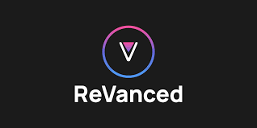
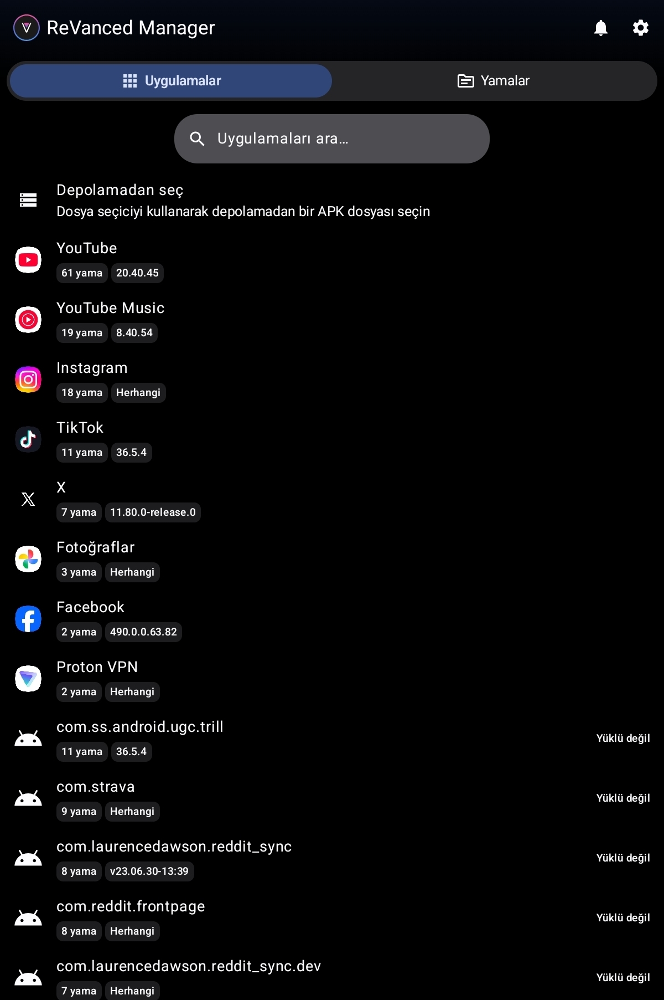

# ReVanced Manager Nedir, Nasıl Kullanılır? APK Yamalama Rehberi

**ReVanced Manager nedir nasıl kullanılır** sorusu, YouTube Vanced projesinin resmi olarak sonlandırılmasının ardından Android cihazında reklamsız video izlemek, arka planda müzik dinlemek ve tam ekran kontrollerini özelleştirmek isteyen milyonlarca kullanıcının en çok araştırdığı konuların başında gelir. İnternette hazır olarak dağıtılan değiştirilmiş APK dosyaları büyük güvenlik ve kötü amaçlı yazılım riskleri taşırken, ReVanced projesi bu sorunu tamamen kökten çözer. ReVanced Manager, hazır modlu dosya dağıtmak yerine orijinal APK dosyalarını kendi cihazınızda güvenle yamalamanızı (patching) sağlayarak hem yasal sınırları korur hem de kullanıcılara tamamen kişiselleştirilebilir bir deneyim sunar.

- - -

## ReVanced Manager Nedir ve Çalışma Mantığı Nasıldır?

**ReVanced Manager**, Android işletim sisteminde başta YouTube ve YouTube Music olmak üzere popüler mobil uygulamaların kod yapısını değiştirerek onlara reklam engelleme, SponsorBlock, dislike sayacını geri getirme ve arka planda oynatma gibi yetenekler kazandıran açık kaynaklı bir yamalama aracıdır. Geçmişte büyük beğeni toplayan YouTube Vanced projesinin manevi devamı olarak topluluk tarafından sıfırdan geliştirilmiştir.

Daha önce incelediğimiz [ReVanced YouTube Nedir? Özellikleri ve Kullanım Rehberi](https://diyom.blogspot.com/2026/10/revanced-youtube-nedir-ozellikleri-ve-kullanim-rehberi-indir.html) içeriğimizde yer alan gelişmiş oynatıcı özelliklerinin tamamı, aslında ReVanced Manager'ın sunduğu modüler yama altyapısı sayesinde hayat bulmaktadır.

- - -

## ReVanced Manager Ne İşe Yarar? Temel Özellikler

ReVanced Manager, sadece standart bir yama aracı değil, Android ekosisteminde kullanıcı özgürlüğünü en üst noktaya taşıyan kapsamlı bir stüdyodur:

| Özellik                         | Sağladığı Avantaj          | Detaylı Açıklama                                                                            |
| ------------------------------- | -------------------------- | ------------------------------------------------------------------------------------------- |
| **Kök (Root) İstemez**          | Sıfır Risk & Kolay Kurulum | Telefonunuzun sistem dosyalarını değiştirmeden standart APK gibi kurulur.                   |
| **Modüler Yama Seçimi**         | Tam Kişiselleştirme        | Reklam engelleme, video hızı veya arayüz butonlarını isteğinize göre açıp kapatabilirsiniz. |
| **GmsCore / microG Desteği**    | Sorunsuz Hesap Girişi      | Google hesabı senkronizasyonunu bağımsız açık kaynak katmanla sağlar.                       |
| **Açık Kaynak Güvenliği**       | Şeffaf Kod Yapısı          | Tüm yama komutları GitHub üzerinden incelenebilir; casus kod içermez.                       |
| **Otomatik Güncelleme Desteği** | Uzun Ömürlü Bakım          | Uygulama sürümleri güncellense bile yamalar minimum bakımla yeni sürümlere adapte olur.     |

- - -

## Adım Adım ReVanced Manager Kurulumu ve Hazırlık

ReVanced Manager ile başarılı ve kararlı bir yamalama gerçekleştirmek için adımları dikkatle izlemeniz gerekir:

### 1. Resmi Uygulamayı İndirin

ReVanced Manager'ı yalnızca resmi GitHub Releases sayfasından veya `revanced.app` resmi web adresinden indirin. Sahte sitelerdeki APK dosyaları zararlı yazılım içerebilir.

### 2. Gerekli İzinleri Tanımlayın

1. İndirdiğiniz `ReVanced Manager.apk` dosyasını telefonunuza yükleyin ve açın.
2. Karşınıza gelen **"Bilinmeyen uygulamaları yükleme"** uyarısında *"Bu kaynaktan izin ver"* seçeneğini aktif edin (Bu izin, yamalanan APK'yı paket yükleyiciye aktarmak için zorunludur).
3. **"Uygulama arka planda çalışmaya devam etsin mi?"** uyarısına *"İzin ver"* deyin; böylece yama işlemi esnasında Android sistemi işlemi yarıda kesmez.
4. Karşınıza çıkan *"Download necessary files?"* sorusuna **OK** diyerek `api.revanced.app` üzerinden gerekli yama tanımlarını indirmesini sağlayın.

### 3. Uygun Orijinal APK Dosyasını Temin Edin

Yamalama işlemini telefonda yüklü YouTube üzerinden doğrudan yapmak için root gerekir. Rootsuz cihazlarda **temiz bir APK dosyası** kullanmalıyız:

* ReVanced Manager içerisinde **Patcher** sekmesine gelin ve **Select an app** butonuna basın.
* Arama kutusuna `youtube` yazın. Uygulamanın yanında önerilen sürüm numarasını göreceksiniz.
* Bu sürüm numarasını **APKMirror** gibi güvenilir bir platformda aratıp saf `.apk` formatında indirin.
* **DİKKAT:** Kesinlikle `APK Bundle` veya `split APK` indirmeyin; ReVanced Manager yalnızca standart tekil `.apk` paketlerini yamalayabilir! Cihazınızdaki uygulamaları yedeklemek isterseniz [APK Extractor ile Yüklü Uygulamalardan APK Alma Rehberi](https://diyom.blogspot.com/2026/10/apk-extractor-ile-yuklu-uygulamalardan-apk-nasil-alinir.html) yöntemlerinden de yararlanabilirsiniz.

- - -

## YouTube APK Nasıl Yamalanır? (Adım Adım Uygulama Rehberi)

Doğru APK dosyasını indirdikten sonra yamalama sürecine geçebilirsiniz:

1. **Storage (Depolama) Üzerinden Dosyayı Seçin:**\
   ReVanced Manager > **Patcher** sekmesine girip sağ alttaki **Storage** (Depolama) butonuna tıklayın. İndirilenler klasörünüzdeki `com.google.android.youtube...` isimli APK dosyasını seçin.
2. **Yamaları Belirleyin:**\
   APK seçildiğinde yama ekranı açılacaktır. Varsayılan olarak önerilen tüm yamalar seçilidir.

   > **Kritik Kural:** Yamalar listesinde yer alan **"GmsCore support"** yamasını kesinlikle kaldırmayın! Bu yama, uygulamanın paket adını özelleştirir ve microG katmanıyla hesap açabilmenizi sağlar.
3. **Yamalamayı Başlatın (Patch):**\
   Sağ alttaki mavi **Patch** butonuna dokunun. Manager dosyaları ayrıştıracak, reklam filtrelerini enjekte edecek ve yeni APK'yı derleyecektir. Bu işlem işlemci hızınıza bağlı olarak 1-3 dakika sürebilir.
4. **Yükleyin (Install):**\
   İşlem tamamlandığında sağ alttaki **Install** butonuna tıklayın. Google Play Store'un bu uygulamayı otomatik güncellemesini engellemeyi unutmayın.

- - -

## GmsCore Kurulumu ve Google Hesabıyla Oturum Açma

Yamalanan YouTube uygulamasını açtığınızda ekranda *"GmsCore yüklü değil"* uyarısı belirecektir:

1. Uygulamanın yönlendirdiği bağlantıdan veya ReVanced resmi GitHub sayfasından güncel **GmsCore** (varsayılan Default sürüm, Huawei cihazlar için Huawei sürümü) APK'sını indirip kurun.
2. GmsCore uygulamasını açın ve **Battery Optimization (Pil Optimizasyonu)** ayarını kapatın. Bu adım bildirimlerin ve arka plan bağlantısının kesilmemesi için gereklidir.
3. Artık yamaladığınız YouTube ReVanced uygulamasını açabilir, hesap simgesine dokunarak Google hesabınızla güvenle oturum açabilirsiniz.

Eğer harici Google servisleri olmadan alternatif ve bağımsız bir YouTube deneyimi arıyorsanız, [NewPipe: YouTube Premium Özelliklerini Ücretsiz Kullanma Rehberi](https://diyom.blogspot.com/2026/10/newpipe-youtube-premium-ucretsiz-kullanim-rehberi.html) içeriğimizdeki bağımsız oynatıcıyı da inceleyebilirsiniz.

- - -

## Sıkça Sorulan Sorular (SSS)

### ReVanced Manager kullanmak için root gerekli midir?

Hayır, ReVanced Manager'ı kullanmak için cihazınızı rootlamanıza kesinlikle gerek yoktur. Depolama (Storage) seçeneği üzerinden APK dosyasını seçip yamaladığınızda, uygulama bağımsız bir paket olarak cihazınıza sorunsuz kurulur ve çalışır.

### ReVanced Manager güvenli midir?

Evet, ReVanced Manager tamamen açık kaynak kodlu ve şeffaf bir yazılımdır. İnternetteki bilinmeyen kaynaklardan hazır modlu APK indirmek yerine, bizzat resmi APKMirror kaynağından aldığınız orijinal dosyayı kendi telefonunuzda yamaladığınız için son derece güvenlidir.

### Neden APK Bundle dosyaları yamalanamıyor?

APK Bundle (`.apkm` veya split APK), Google Play'in parçalı dağıtım formatıdır ve tek parça bir bayt kodu yapısına sahip değildir. ReVanced Patcher mekanizması yalnızca tekil, eksiksiz ve standart `.apk` arşivlerini derleyip yamalayabilir.

### Yamalanan YouTube neden otomatik güncellenmemeli?

Google Play Store orijinal YouTube'u güncellerse, yamalanmış sürümün üzerine orijinal kodlar yazılabilir veya paket çakışması yaşanabilir. Bu sebeple Play Store üzerinden YouTube'un otomatik güncellemelerini kapatmanız önerilir.

- - -

## Kullanılan İç Bağlantılar

* [ReVanced YouTube Nedir? Özellikleri ve Kullanım Rehberi](https://diyom.blogspot.com/2026/10/revanced-youtube-nedir-ozellikleri-ve-kullanim-rehberi-indir.html)
* [APK Extractor ile Yüklü Uygulamalardan APK Alma Rehberi](https://diyom.blogspot.com/2026/10/apk-extractor-ile-yuklu-uygulamalardan-apk-nasil-alinir.html)
* [NewPipe: YouTube Premium Özelliklerini Ücretsiz Kullanma Rehberi](https://diyom.blogspot.com/2026/10/newpipe-youtube-premium-ucretsiz-kullanim-rehberi.html)

- - -

<!-- Görsel Önerisi 3: ReVanced Manager depolamadan APK secme ve patch baslatma ekrani -->

<!-- Alt Text: revanced manager youtube apk yamalama ve patch adimlari -->

<!-- Görsel Önerisi 2: APKMirror üzerinden YouTube saf APK indirme adımları -->

<!-- Alt Text: revanced manager icin youtube apk indirme ve apkmirror secimi -->

<!-- Görsel Önerisi 1: ReVanced Manager ana kontrol paneli (Dashboard) ve yamalama ekranı -->

<!-- Alt Text: revanced manager nedir nasil kullanilir kontrol paneli ve yama secimi -->

<!--
SEO ve İçerik Meta Bilgileri:
- primary_keyword: revanced manager nedir nasıl kullanılır
- secondary_keywords: revanced manager kurulumu, youtube apk yamalama, gmscore revanced, revanced patcher rehberi
- lsi_keywords: apkmirror youtube apk, rootsuz youtube reklam engelleme, revanced vanced farkı, gmscore support yaması
- Önerilen Kategori: Mobil Uygulamalar / Android Araçları ve Rehberler
- Önerilen Etiketler: revanced-manager, revanced, youtube, apk-yamalama, gmscore, android, vanced
-->
