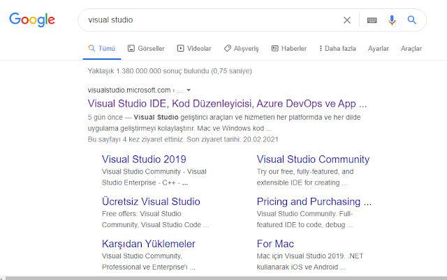
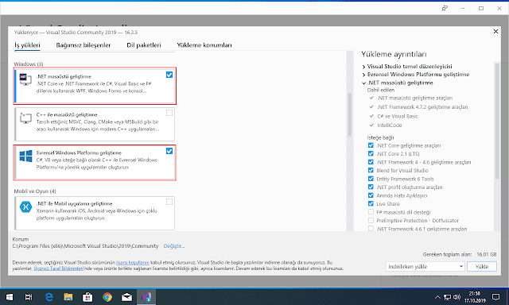
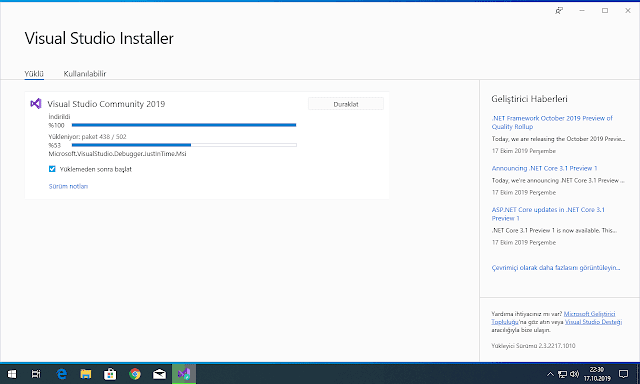

# Visual Studio Nasıl Kurulur? C# ve .NET Geliştirme Ortamı Kurulum Rehberi

Yazılım dünyasına adım atıyorsanız veya C# programlama dilini öğrenmeye karar verdiyseniz, ilk ve en önemli adımınız kodlarınızı yazıp çalıştıracağınız güçlü bir geliştirme ortamı (IDE) kurmaktır. Microsoft'un amiral gemisi olan **Visual Studio**, tam da bu noktada profesyonel özellikleriyle yeni geliştiricilerin en büyük yardımcısıdır.

Bu rehberimizde Visual Studio'nun ne olduğunu öğrenecek, Community sürümünü adım adım bilgisayarınıza kuracak ve C# için gerekli paketleri yapılandıracağız.

## Visual Studio Nedir?

Microsoft Visual Studio, geliştiricilerin Windows, web, mobil ve bulut platformları için yüksek performanslı uygulamalar geliştirmesini sağlayan gelişmiş bir Tümleşik Geliştirme Ortamı (IDE)'dır. C#, C++, F#, Python ve TypeScript gibi popüler dilleri destekler.

### Visual Studio Sürümleri Nelerdir?

* **Community:** Bireysel geliştiriciler, açık kaynak projeler, öğrenciler ve küçük ekipler için tamamen ücretsiz ve tam özellikli sürümdür.
* **Professional:** Profesyonel geliştiriciler ve küçük/orta ölçekli ekipler için gelişmiş araçlar sunar.
* **Enterprise:** Büyük kurumsal yapılar ve takımlar için tasarlanmış en kapsamlı sürümdür.

## Adım Adım Visual Studio Kurulumu

Kurulum süreci oldukça basittir ancak doğru iş yüklerini (workloads) seçmek projenizin sorunsuz çalışması için kritik önem taşır.

### 1. Visual Studio Installer'ın İndirilmesi

Resmi Microsoft Visual Studio indirme sayfasından **Community** sürümünü indirin. İndirilen kurulum yöneticisine (`Visual Studio Installer`) tıklayarak ilk yükleme ekranını başlatın.

### 2. Gerekli İş Yüklerinin (Workloads) Seçilmesi

Installer kurulumu tamamlandıktan sonra karşınıza farklı geliştirme alanlarını içeren bir pencere gelecektir. C# ile masaüstü ve konsol uygulamaları geliştirmek için bu ekrandan şu seçenekleri işaretlemelisiniz:

* **.NET masaüstü geliştirme**
* **Evrensel Windows Platformu geliştirme**

### 3. Dil Paketleri ve Yükleme

Üst sekmeden **Dil Paketleri** bölümüne giderek varsayılan Türkçe dilinin yanı sıra **İngilizce** dil paketini de seçebilirsiniz (yazılım dünyasında terimlere aşina olmak için İngilizce kullanımı önerilir). Ardından sağ alt köşedeki **Yükle** butonuna basarak indirme ve kurulum işlemini başlatın. İnternet hızınıza bağlı olarak bu işlem birkaç dakika sürebilir.

- - -
